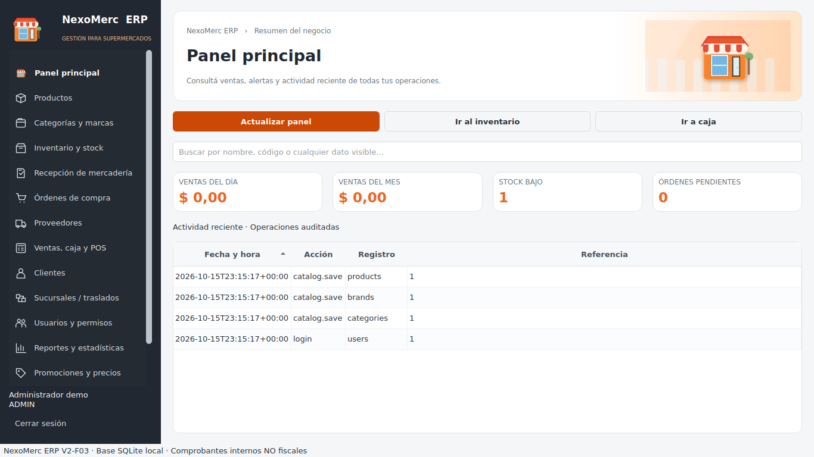
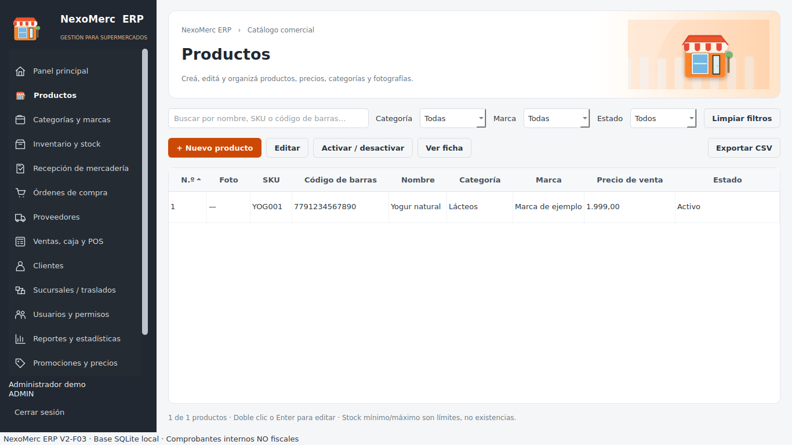
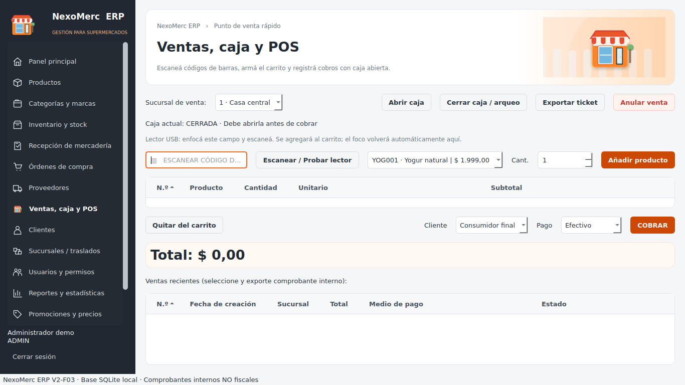

# 🛒 NexoMerc ERP — Edición DEMO de portafolio

**Gestión para supermercados y comercios minoristas · QuintaDimensión Tecnología**


[](https://github.com/carlos-adrian-ledesma/nexomerc-erp/actions/workflows/backend-tests.yml)

`Python` · `PySide6` · `SQLite` · `Windows` · `Desktop ERP` · `POS` · `Inventario` · `Comercio minorista`

NexoMerc ERP es una aplicación de escritorio orientada a centralizar la gestión comercial: **productos, stock, compras, recepción, proveedores, ventas, caja, clientes, sucursales, permisos, reportes y auditoría**. Incluye una interfaz visual en tonos naranja/gris y utiliza una base de datos SQLite local.

> **Alcance:** repositorio de portafolio con código de demostración para evaluación no comercial. No ofrece sincronización multi-PC/Internet ni IA/bots; los tickets son comprobantes **internos, NO FISCALES**. No se declara aptitud para producción sin validación funcional y normativa.

## 📌 Funcionalidades principales

| Área | Capacidades incluidas en el código de esta revisión |
| --- | --- |
| **Panel principal** | Indicadores de ventas diarias/mensuales, alertas de stock, órdenes pendientes y actividad reciente. |
| **Productos** | SKU, código de barras, fotografías, categorías, marcas, proveedor, costo/precio, presentación y archivo/restauración de productos. |
| **Inventario** | Existencia y disponible por sucursal, stock mínimo/máximo, entradas, ajustes, conteo físico, reservas y Kardex. |
| **Recepción** | Recepción manual por unidad base, paquete o caja; factor de conversión, referencia/remito, vencimiento y registro de movimientos. |
| **Compras** | Órdenes de compra, aprobación/envío, recepción de pedidos y actualización transaccional de stock. |
| **Proveedores** | Datos comerciales y vinculación a compras/productos. |
| **Ventas y POS** | Catálogo visual, lector tipo teclado para códigos de barras, carrito, control de disponibilidad, medios de pago, caja y anulaciones. |
| **Caja** | Apertura, cierre, arqueo y consulta de ventas recientes. |
| **Clientes y promociones** | Fichas de clientes, historial de compras, precios promocionales, reglas/cupones de fidelización. |
| **Sucursales** | Gestión de sucursales y traslados de mercancía con salida y recepción. |
| **Usuarios y permisos** | Administrador inicial, roles predefinidos, permisos granulares y restricciones por sucursal. |
| **Reportes** | Ventas, productos y reportes operativos; exportación CSV. |
| **Auditoría** | Histórico de operaciones, cadena de hashes y exportación CSV. |
| **Configuración** | Identidad comercial, moneda/localización, preferencias e impresión de tickets internos. |

La explicación técnica y funcional, los límites y cada operación están en [**docs/FUNCIONALIDADES.md**](docs/FUNCIONALIDADES.md).

## 🖼️ Capturas de la aplicación

> Las siguientes son **capturas reales históricas F03** aportadas con el proyecto. El layout del POS y otras vistas fueron actualizados posteriormente hasta la revisión **F22**; estas imágenes NO representan necesariamente el aspecto actual exacto.

| Panel principal | Catálogo de productos |
| --- | --- |
|  |  |

**Punto de venta, captura histórica F03:**



## 🖥️ Instalación rápida — Windows 10/11 (64 bits)

- **Python 3.13 de 64 bits recomendado para esta entrega**. Python 3.12 también es una opción, pero **la revisión F22 no se ha validado aún interactivamente en Windows**.
- Dependencia de interfaz: `PySide6==6.10.2`.
- Git opcional para clonar; no es necesario para ejecutar el ZIP.

**Opción sencilla:** ejecutar `INSTALAR_DEMO_WINDOWS.bat` y después `INICIAR_DEMO_WINDOWS.bat` (consola visible para detectar errores).

**Opción PowerShell:**

```powershell
py -3.13 -m venv .venv
.\.venv\Scripts\python.exe -m pip install --upgrade pip
.\.venv\Scripts\python.exe -m pip install -r requirements.txt
$env:NEXOMERC_DATA_DIR = (Join-Path (Get-Location) 'data\demo_local')
.\.venv\Scripts\python.exe run.py
```

Al abrir una base nueva, la aplicación solicita crear un **administrador propio**. No hay contraseña fija ni cuenta preconfigurada. Usar exclusivamente datos ficticios. `data/demo_local/` está ignorada por Git.

Instrucciones ampliadas: [**docs/INSTALACION_WINDOWS.md**](docs/INSTALACION_WINDOWS.md) · [**docs/DEMO.md**](docs/DEMO.md).

## 🧪 Pruebas

Sin abrir Qt, se puede ejecutar la batería de lógica de negocio:

```powershell
.\.venv\Scripts\python.exe scripts\test_backend.py
```

En un equipo con PySide6 instalado, ejecutar la batería total:

```powershell
.\.venv\Scripts\python.exe -m unittest discover -s tests -v
```

Para revisar archivos sensibles antes de subir a GitHub:

```powershell
.\.venv\Scripts\python.exe scripts\check_publication.py
```

Las pruebas no sustituyen una inspección visual completa ni la validación de impresoras o lectores físicos. Ver [**PUBLIC_RELEASE_CHECKLIST.md**](PUBLIC_RELEASE_CHECKLIST.md).

## 🔐 Seguridad, datos y alcance

- Autenticación con **PBKDF2-HMAC-SHA256**, salt individual y 310.000 iteraciones. No incluye claves maestras.
- Control de acceso por rol/módulo y restricciones de sucursal en el motor.
- Base SQLite creada fuera del código; con la variable `NEXOMERC_DATA_DIR` se puede aislar un entorno DEMO.
- Los datos almacenados en SQLite **no están cifrados completamente**. No se deben cargar datos sensibles reales en la demostración pública.
- El software no es un sistema de facturación fiscal homologado.
- No se incluyen APIs de IA, bots, sincronización por LAN/Internet, ni licencias comerciales transferibles.

[Arquitectura](docs/ARCHITECTURE.md) · [Seguridad](docs/SECURITY.md) · [Base de datos](docs/DATABASE.md) · [Licencia](LICENSE.md)

## 📂 Estructura

```text
NexoMerc_ERP/
├── nexomerc/                  # Núcleo, GUI, traducciones y lógica comercial
├── assets/                    # Iconos, identidad y recursos de la aplicación
├── docs/                      # Capturas y manuales técnicos/funcionales
├── tests/                     # Pruebas de regresión
├── scripts/                   # Validación del motor y control de publicación
├── .github/workflows/         # CI de pruebas de lógica sin Qt
├── run.py                     # Entrada principal
├── INSTALAR_DEMO_WINDOWS.bat  # Crea .venv e instala requisitos
├── INICIAR_DEMO_WINDOWS.bat   # Arranca con datos DEMO aislados
├── requirements.txt
├── PUBLIC_RELEASE_CHECKLIST.md
├── CHANGELOG.md
└── LICENSE.md
```

## 🏷️ Estado y versiones

**Revisión de interfaz/código recibido:** V2-F22. El archivo `VERSION.txt` conserva `2.0.14` por compatibilidad histórica con pruebas y scripts antiguos; no representa el número visual F22. Las validaciones interactivas de Windows y periféricos figuran como pendientes.

## 🧑‍💻 Autoría y contacto

**QuintaDimensión Tecnología** · [GitHub: carlos-adrian-ledesma](https://github.com/carlos-adrian-ledesma).

Para solicitar personalizaciones, implementación empresarial o una licencia comercial, utilizar los canales públicos indicados en el perfil de GitHub. No publicar claves, contraseñas ni datos de clientes en Issues.

## 📜 Licencia

**Código disponible para evaluación no comercial, no open source.** Ver [LICENSE.md](LICENSE.md). El hecho de poder leer y clonar el repositorio no concede permiso para revender el producto ni utilizar su código en un sistema comercial sin autorización.
